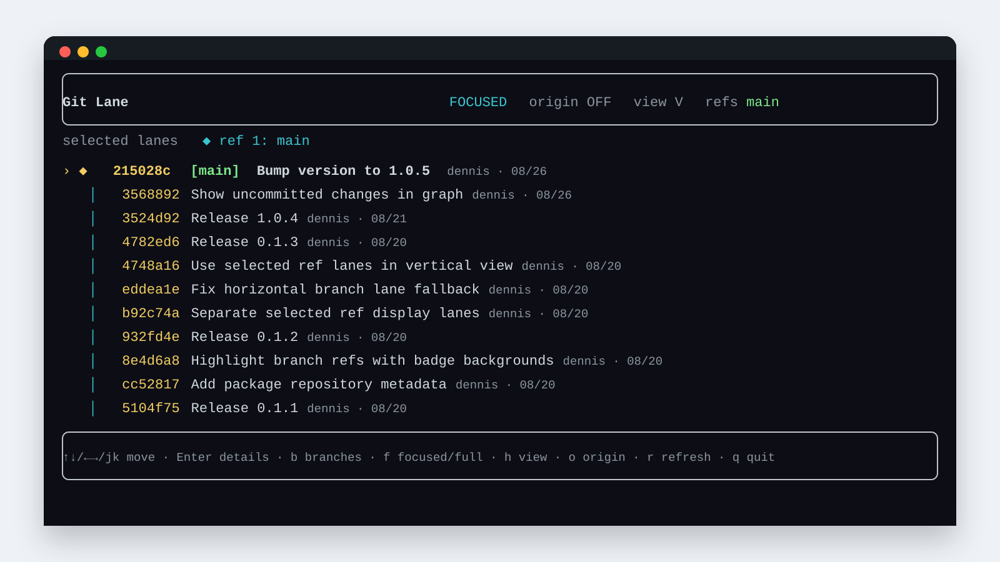
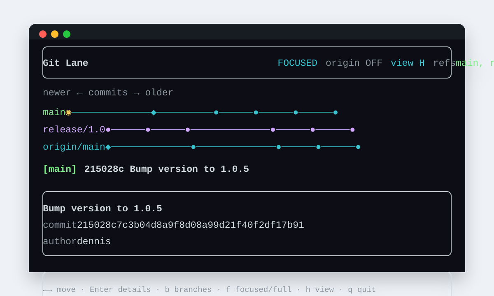
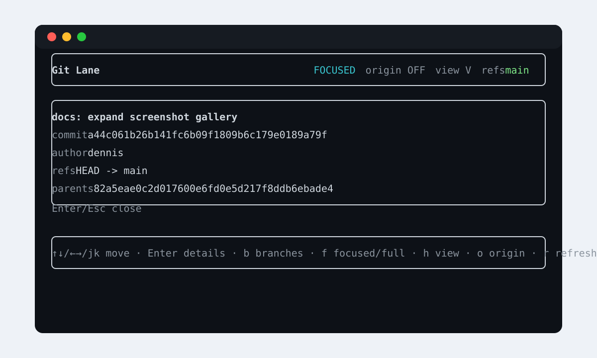

# Git Lane

A focused Git lane TUI for local development.

## Screenshots

<p>
  
  
</p>
<p>
  
  
</p>
<p>
  
</p>

<sub>Screenshots are real renders of a small demo repository.</sub>

The default view starts from the current branch. It also starts in **FOCUSED** history mode, which follows first-parent history so unrelated merged branches do not explode the graph into dozens of lanes.

## Screen layout

**Toolbar** — the top line shows what you are looking at:

```
✦ Git Lane   Branches main, feat/login · focused   [✓] Show Remote Branches   ↕  42 commits
```

- `Branches` lists the selected refs (`all branches` when every ref is selected, `+N` when they do not fit), followed by the history mode: `focused` or `full history`.
- `[✓] Show Remote Branches` reflects the `o` toggle.
- `↕` is the vertical table view, `↔` the horizontal timeline (`h`).

**Commit table** — one row per commit with **Graph · Description · Date · Author · Commit** columns. On narrow terminals the Author column, then the Date column, drop out.

- Branch refs appear as chips before the subject. When a local branch and its `origin/` counterpart point at the same commit they share one chip (`main │ origin`); `○` marks the checked-out branch.
- Graph nodes: `●` is `HEAD`, `┃` is any other commit (its lane is drawn thicker), `○` is the uncommitted worktree row.
- Merge commits and the worktree row are dimmed.
- A **Details** pane sits beside the table (below it under 100 columns); toggle it with `d`.

## Run locally

```bash
pnpm install
pnpm dev
```

Use another base branch:

```bash
pnpm dev -- --base develop
```

## Keyboard

- `↑` / `↓` / `←` / `→` or `j` / `k`: move through commits
- `Enter`: open the commit's changed files and diffs
- `d`: toggle the side details pane
- `b`: choose visible branch refs
- `:`: open command prompt
- `Space`: toggle a branch in the filter
- `Enter` in branch filter: apply selected branches
- `Esc` in branch filter: cancel
- `f`: toggle **FOCUSED / FULL** history
- `h`: toggle vertical (`↕`) / horizontal (`↔`) view
- `o`: toggle origin branches on/off
- `r`: refresh
- `q`: quit

### Files and diffs

`Enter` on a commit lists its changed files (with `+/-` line counts) next to a diff preview of the selected file.
On narrow terminals (< 100 columns) only one pane is shown at a time.
The uncommitted worktree row diffs against `HEAD` and includes untracked files; merge commits are compared against their first parent.

- `↑` / `↓` or `j` / `k`: pick a file (file list) or scroll (diff)
- `Enter` / `→`: focus the diff, `Esc` / `←`: back to the file list
- `Space` / `u`: page down/up, `g` / `G`: top/bottom
- `n` / `p`: next/previous file while reading a diff
- `q`: back to the graph

### Command prompt

Press `:` while viewing the graph to run shell commands from inside `gln`.
Commands run in the current working directory and their output appears in the prompt.
Use `cd <path>` to change the prompt directory, `clear` to reset prompt output, `exit` or `Esc` to return to the graph.

### Focused vs Full

**FOCUSED** is the default. It follows the first-parent history of the selected refs and filters parent edges that are outside the visible revision set. This is intended for the common “base branch + my working branch” view.

**FULL** traverses all parents of the selected refs, so merged side branches are visible as well.

The toolbar shows the active mode next to the branch list (`· focused` / `· full history`).

## Install as a local command

From npm:

```bash
pnpm add --global @olennis/git-lane
```

For local development:

```bash
pnpm build
pnpm link --global
```

Then, inside any Git repository:

```bash
git-lane
```

Short alias:

```bash
gln
```

## Release flow

`main` only contains release commits (`release: vX.Y.Z`). Day-to-day work goes to `develop`:

1. Work on a feature branch and squash-merge it into `develop`.
2. Push `develop`. CI builds, tests and publishes the next patch version to npm (run the workflow manually to pick `minor` / `major`).
3. CI then appends one `release: vX.Y.Z` commit to `main` — the `develop` snapshot plus the version bump — listing the included commits and a `Release-Source` trailer. `main` is never pushed to directly or force-pushed.

The version comes from `main`'s `package.json`, so `develop` does not need bump commits.

## Implementation notes

The graph renderer is implemented from commit/parent data rather than parsing `git log --graph`, keeping Git I/O and terminal rendering independently testable.
